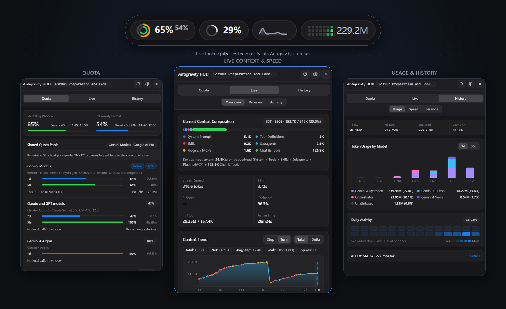

<div align="center">

# Antigravity Desktop HUD (`antigravity-desktop-hud`)

**A status bar for Google Antigravity Desktop that tracks live context usage, generation speed, model quota, and local token history.**


<br />



</div>

## Let an agent install it for you

Paste this prompt into your AI coding agent (Antigravity, Claude Code, Cursor, or Codex):

```text
Install Antigravity Desktop HUD (`antigravity-desktop-hud`) for me:
1. Check `node -v` and confirm Node.js is >= 22.4.0 (stop and tell me if it isn't).
2. Run `npx -y antigravity-desktop-hud check` to locate Antigravity's `app.asar` (if not found automatically, locate it and pass `--path <path-to-app.asar>`).
3. Run `npx -y antigravity-desktop-hud install` to back up and patch `app.asar`. If it fails because `app.asar` is locked by a running Antigravity process:
   - If you are an external agent (Claude Code, Cursor, Codex), ask me to close Antigravity and retry.
   - If you are running inside Antigravity itself, give me the exact `npx -y antigravity-desktop-hud install` command to run in my terminal after I close Antigravity.
4. Once installed, run `npx -y antigravity-desktop-hud status` to verify and summarize the result so I know when to restart Antigravity.
```

> [!TIP]
> Prefer not to modify files on disk? Tell the agent to launch Antigravity with `--remote-debugging-port=9222` and run `npx -y antigravity-desktop-hud live` instead of `install`.

## Requirements

- Node.js `>= 22.4.0` (uses built-in `node:sqlite`, `node:test`, and native WebSocket/fetch APIs)
- Google Antigravity desktop app

## Installation

Install globally via npm (recommended):

```bash
npm install -g antigravity-desktop-hud
```

Or run directly without installing via `npx -y antigravity-desktop-hud <check|install|status|live|restore>` (for example, `npx -y antigravity-desktop-hud install`).

Choose between permanent patching or live injection over CDP.

### Option 1: Permanent install (patches `app.asar`)

1. Close Antigravity completely.
2. Verify path detection (pass `--path <path-to-app.asar>` if Antigravity is in a custom location):

   ```bash
   antigravity-desktop-hud check
   ```

3. Install Antigravity HUD (automatically backs up the original `app.asar` before patching):

   ```bash
   antigravity-desktop-hud install
   ```

4. Reopen Antigravity.

#### Auto-repatch after Antigravity updates

Antigravity updates overwrite `app.asar` and drop the HUD patch. To handle this without manual terminal commands, `antigravity-desktop-hud install` also installs a small Antigravity plugin at `~/.gemini/config/plugins/antigravity-hud-watcher/` (with a `hooks.json` entry and a local copy of the HUD files).

`SessionStart` and `PreInvocation` hooks when a session runs:
- If `app.asar` is still patched, the hook exits right away and does nothing.
- If an Antigravity update replaced `app.asar`, it sends a system notification (`Antigravity updated. Restart Antigravity to reload HUD.`) and starts a background helper that tracks the running Antigravity PIDs, waits for them to exit, refreshes `app.asar.bak`, and re-patches `app.asar` for the next launch (logging to `~/.antigravity-context-bar/watcher.log`).

Running `antigravity-desktop-hud restore` restores the original `app.asar` from backup and deletes `~/.gemini/config/plugins/antigravity-hud-watcher/`.

To uninstall and restore the original `app.asar` and remove the watcher plugin:

```bash
antigravity-desktop-hud restore
```

### Option 2: Live injection (CDP, no files modified)

1. Launch Antigravity with debugging enabled:

   ```bash
   antigravity --remote-debugging-port=9222
   ```

2. Start the live injector bridge (pass `--port <cdpPort>` for a non-default port; press `Ctrl+C` to detach):

   ```bash
   antigravity-desktop-hud live
   ```

### From source (optional)

```bash
git clone https://github.com/KOlCIqwq/Antigravity-Desktop-HUD.git
cd Antigravity-Desktop-HUD
npm link
```

## CLI commands

| Command | Description |
|---|---|
| `antigravity-desktop-hud check [--path <path>]` | Verify Antigravity `app.asar` path |
| `antigravity-desktop-hud status [--path <path>] [--port <port>]` | Show patch status, backup file, watcher plugin status, and active CDP windows |
| `antigravity-desktop-hud install [--path <path>]` | Back up and patch `app.asar` |
| `antigravity-desktop-hud restore [--path <path>]` | Restore original `app.asar` from backup |
| `antigravity-desktop-hud live [--port <port>]` | Inject via CDP without disk modifications |

## Development and testing

Rebuild the renderer bundle and run the test suite:

```bash
npm test
```

## License

MIT
